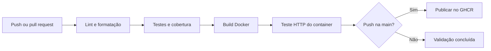

# DevOps Pipeline

[](https://github.com/maridevops/devops-pipeline/actions/workflows/pipeline.yml)

Projeto de portfólio com Python, FastAPI, Docker e GitHub Actions. Automatiza a validação de uma API e a entrega da imagem no GitHub Container Registry (GHCR).

## Como funciona



Pull requests executam todas as verificações sem publicar imagens. Pushes na `main` publicam a mesma imagem testada com tags `latest` e `sha-<commit completo>`. Uma falha bloqueia as etapas seguintes.

A entrega da imagem não hospeda a API na internet. Um deploy em nuvem exige definir um provedor ou servidor.

## Executar com Docker

Pré-requisito: Docker com Compose.

```sh
docker compose up --build -d
docker compose ps
```

Acesse [a API](http://localhost:8000), [o health check](http://localhost:8000/health) ou [a documentação interativa](http://localhost:8000/docs).

```sh
docker compose logs api
docker compose down
```

O container executa sem root, com filesystem somente leitura e capacidades removidas no Compose e no teste da pipeline.

## Executar com Python

Use Python 3.12. No Windows PowerShell:

```powershell
python -m venv .venv
.\.venv\Scripts\python.exe -m pip install -r requirements-dev.txt
.\.venv\Scripts\python.exe -m uvicorn app.main:app --reload
```

Linux/macOS:

```sh
python3.12 -m venv .venv
.venv/bin/python -m pip install -r requirements-dev.txt
.venv/bin/python -m uvicorn app.main:app --reload
```

## Verificar qualidade

Execute com o Python do ambiente virtual:

```sh
python -m ruff check .
python -m ruff format --check .
python -m pytest
```

A cobertura mínima configurada é 90%. Os testes verificam os endpoints, a versão configurada por ambiente e respostas a rota inexistente e método inválido.

## Imagem publicada

Após a primeira execução bem-sucedida, a imagem fica em `ghcr.io/maridevops/devops-pipeline`. O workflow utiliza o `GITHUB_TOKEN` automático e a permissão `packages: write`, sem exigir token pessoal nos secrets.

O pacote pode começar privado mesmo com repositório público. Para downloads anônimos, torne o pacote público nas configurações do GHCR. Pacotes privados exigem login local com acesso de leitura.

```sh
docker run --rm -p 127.0.0.1:8000:8000 ghcr.io/maridevops/devops-pipeline:latest
```

Encerre o Compose antes para liberar a porta 8000. Substitua `latest` por `sha-<commit completo>` para executar uma versão específica. Consulte `/version` para conferir o commit.

## Demonstrar no portfólio

1. Crie uma branch e altere a mensagem em `app/main.py`.
2. Abra um pull request para `main`.
3. Acompanhe a validação em Actions.
4. Faça o merge e acompanhe a publicação da imagem.
5. Baixe a imagem e consulte `/version`.

## Manutenção

Dependabot propõe atualizações semanais de Python, Docker e GitHub Actions. As dependências Python têm versões fixadas nos arquivos `requirements*.txt`; revise-os juntos. As actions usam tags de versão e a base usa `python:3.12-slim`, que podem receber atualizações.

Para regenerar dependências em Python 3.12, instale `pip-tools` no ambiente virtual:

```sh
python -m piptools compile --strip-extras --output-file requirements.txt requirements.in
python -m piptools compile --strip-extras --output-file requirements-dev.txt requirements-dev.in
```

## Referências

- [Publicar imagens com GitHub Actions](https://docs.github.com/en/actions/tutorials/publish-packages/publish-docker-images)
- [GitHub Container Registry](https://docs.github.com/en/packages/working-with-a-github-packages-registry/working-with-the-container-registry)
- [FastAPI em containers](https://fastapi.tiangolo.com/deployment/docker/)
